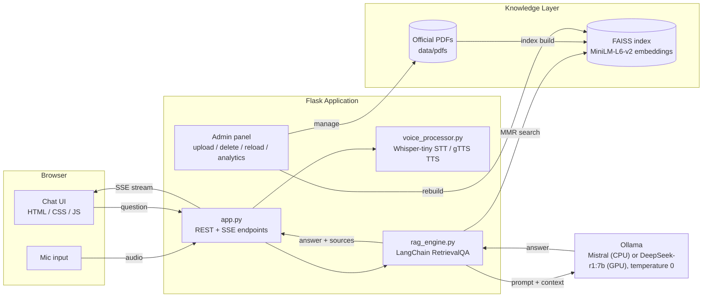
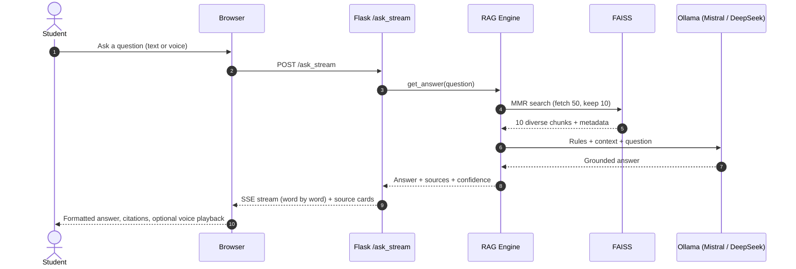
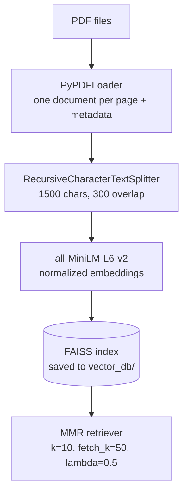

# University AI Assistant

A private, local RAG chatbot that answers student questions from official University of Malakand documents, with page-level citations and voice support.


---

## Overview

Students often struggle to find simple answers inside long regulation PDFs — for example, the attendance rule, the migration process, or the harassment complaint procedure.

University AI Assistant solves this with Retrieval-Augmented Generation (RAG). It indexes the university's official PDFs, finds the most relevant passages for each question, and asks a local LLM to answer using only those passages. Every answer comes with source files and page numbers, so students can verify it.

Everything runs locally. No paid API, no data sent to third-party LLM providers.

The LLM is configurable per machine: Mistral on CPU-only machines, or DeepSeek-r1:7b on machines with a GPU — set with a single environment variable (`OLLAMA_MODEL`), no code changes needed. Both have been tested and work.

---

## Features

| Feature | Details |
|---|---|
| Grounded answers (RAG) | Answers come from the indexed PDFs, not from the model's memory |
| Multi-document search | MMR retrieval pulls diverse chunks across many PDFs |
| Source citations | Up to 8 sources per answer, with file name, page and text preview |
| Newest-rule-wins prompt | Prompt tells the model to prefer 2024/2025 regulations over older documents |
| Live streaming UI | Answers stream word-by-word over Server-Sent Events (SSE) |
| Voice input | Speech-to-text with OpenAI Whisper (tiny) |
| Voice output | Text-to-speech with gTTS |
| Admin panel | Upload / delete PDFs, rebuild the index, view analytics |
| Analytics | Total questions, average response time, most-asked questions |
| Private by design | LLM, embeddings and vector search all run on your own machine |

---

## System Architecture



### Request flow



### Indexing pipeline



---

## Design Decisions

| Decision | Why |
|---|---|
| RAG instead of fine-tuning | Regulations change. Re-indexing a PDF is minutes; retraining a model is not. |
| Local LLM via Ollama | Zero API cost, works offline, and no student questions leave the machine. |
| Per-machine model selection (Mistral / DeepSeek) | One codebase, no code changes: `OLLAMA_MODEL=mistral` on CPU-only hardware, `OLLAMA_MODEL=deepseek-r1:7b` on hardware with a GPU. |
| MMR retrieval (k=10 from 50) | Rules are spread across several documents. MMR avoids returning ten near-duplicate chunks. |
| 1500-char chunks, 300 overlap | Keeps full legal clauses together so a rule is not cut in half. |
| Temperature 0 | Regulations need exact numbers (days, percentages). No creativity wanted. |
| Document-priority prompt | Graduate Degree Regulations 2024 (Amended 2025) and Semester Regulations 2024 are checked first; older documents are last. |
| Citations on every answer | Students can open the exact page and verify. |
| Confidence label | Simple heuristic: more distinct source PDFs means higher confidence (`high` >= 4, `medium` >= 2). |

---

## Tech Stack

| Layer | Technology |
|---|---|
| Backend | Flask 3, Server-Sent Events |
| RAG orchestration | LangChain (`RetrievalQA`, `PromptTemplate`) |
| LLM runtime | Ollama, Mistral (CPU) or DeepSeek-r1:7b (GPU) |
| Embeddings | `sentence-transformers/all-MiniLM-L6-v2` |
| Vector store | FAISS (CPU) |
| PDF parsing | PyPDF |
| Speech-to-text | OpenAI Whisper-tiny (Hugging Face Transformers), librosa |
| Text-to-speech | gTTS |
| Frontend | HTML, CSS, vanilla JavaScript (Jinja2 templates) |

---

## Project Structure

```text
University_AI_Chatbot/
├── app.py                 # Flask app: chat, voice, status and admin routes
├── rag_engine.py          # PDF loading, chunking, FAISS index, retrieval + QA chain
├── voice_processor.py     # Whisper speech-to-text and gTTS text-to-speech
├── config.py              # All settings: model, RAG parameters, prompt, paths
├── requirements.txt
├── data/
│   └── pdfs/               # Official university documents (22 PDFs)
├── templates/
│   ├── index.html          # Chat interface
│   ├── admin_login.html
│   └── admin_dashboard.html
└── static/
    ├── style.css
    └── campus.jpg
```

`vector_db/`, `logs/`, `temp/` and `analytics.json` are created automatically at runtime.

---

## Getting Started

### Prerequisites
- Python 3.11
- [Ollama](https://ollama.com/download) installed
- ~8 GB RAM recommended (GPU optional)
- Internet is needed only for first-time model downloads and for gTTS voice output

### 1. Clone

```bash
git clone https://github.com/MuhammadAbbas01/University_AI_Chatbot.git
cd University_AI_Chatbot
```

### 2. Pull the LLM

```bash
# CPU machine
ollama pull mistral
# or, GPU machine
ollama pull deepseek-r1:7b

ollama serve
```

### 3. Create environment and install

```bash
python -m venv .venv

# Windows
.venv\Scripts\activate
# Linux / macOS
source .venv/bin/activate

pip install -r requirements.txt
```

### 4. Run

```bash
python app.py
```

Open http://localhost:5000

The first run builds the FAISS index from all PDFs and downloads the embedding and Whisper models. This can take a few minutes. Next runs load the saved index and start much faster.

---

## Configuration

All settings live in [`config.py`](config.py).

| Setting | Default | Meaning |
|---|---|---|
| `OLLAMA_MODEL` | `mistral` | Any model you have pulled in Ollama (e.g. `deepseek-r1:7b` on GPU). Override with the `OLLAMA_MODEL` environment variable |
| `CHUNK_SIZE` / `CHUNK_OVERLAP` | `1500` / `300` | Text splitting |
| `TOP_K_RESULTS` | `10` | Chunks sent to the LLM |
| `FETCH_K` | `50` | Candidates considered by MMR |
| `LAMBDA_MULT` | `0.5` | Relevance vs diversity balance |
| `TEMPERATURE` | `0.0` | Fully factual output |
| `PORT` | `5000` | Web server port |

To add documents: put PDFs in `data/pdfs/` (or upload them from the admin panel) and rebuild the index.

---

## API Reference

| Method | Endpoint | Description |
|---|---|---|
| `GET` | `/` | Chat interface |
| `POST` | `/ask_stream` | Ask a question. Returns an SSE stream, then sources and metadata |
| `POST` | `/voice/transcribe` | Upload audio (`wav`, `mp3`, `ogg`, `webm`, `m4a`) and get text |
| `POST` | `/voice/synthesize` | Send text and get an MP3 |
| `GET` | `/status` | System health, model, PDF count, average response time |
| `GET` | `/history` | Chat history for the current session |
| `POST` | `/clear` | Clear session history |
| `GET` | `/admin` | Admin login |
| `POST` | `/admin/upload`, `/admin/delete/<file>`, `/admin/reload` | Manage PDFs and rebuild the index (admin only) |

Example request:

```bash
curl -N -X POST http://localhost:5000/ask_stream \
  -H "Content-Type: application/json" \
  -d '{"question": "What is the minimum attendance requirement?"}'
```

---

## Known Limitations

Being honest about the current state:

- Runs on Flask's built-in server with in-memory session history. It is designed for a single-machine demo or pilot, not for thousands of simultaneous users.
- One local LLM instance handles all requests, so answers are queued under heavy load.
- Streaming is a UX layer: the answer is generated first, then streamed to the browser.
- The confidence label is a heuristic based on source count, not a measured accuracy score.
- Answer quality depends on the PDF text quality. Scanned PDFs without a text layer are not searchable.
- Admin credentials and the Flask secret key have defaults in `config.py` for local demo use, but can be overridden with the `ADMIN_PASSWORD` and `SECRET_KEY` environment variables. Always override them before any real deployment.

---

## Roadmap

- [x] Move secrets to environment variables
- [ ] Docker + docker-compose (app + Ollama)
- [ ] Production server (Gunicorn / Waitress) and persistent chat history
- [ ] Evaluation set with retrieval hit-rate and answer-accuracy metrics
- [ ] OCR for scanned PDFs
- [ ] Urdu question support
- [ ] Automated tests and CI

---

Independent project. Not officially affiliated with the University of Malakand. Always confirm important decisions with the university.

## Author

**Muhammad Abbas** — AI/ML Engineer
GitHub: [@MuhammadAbbas01](https://github.com/MuhammadAbbas01)

---

<sub>Built with Flask, LangChain, FAISS and Ollama.</sub>
